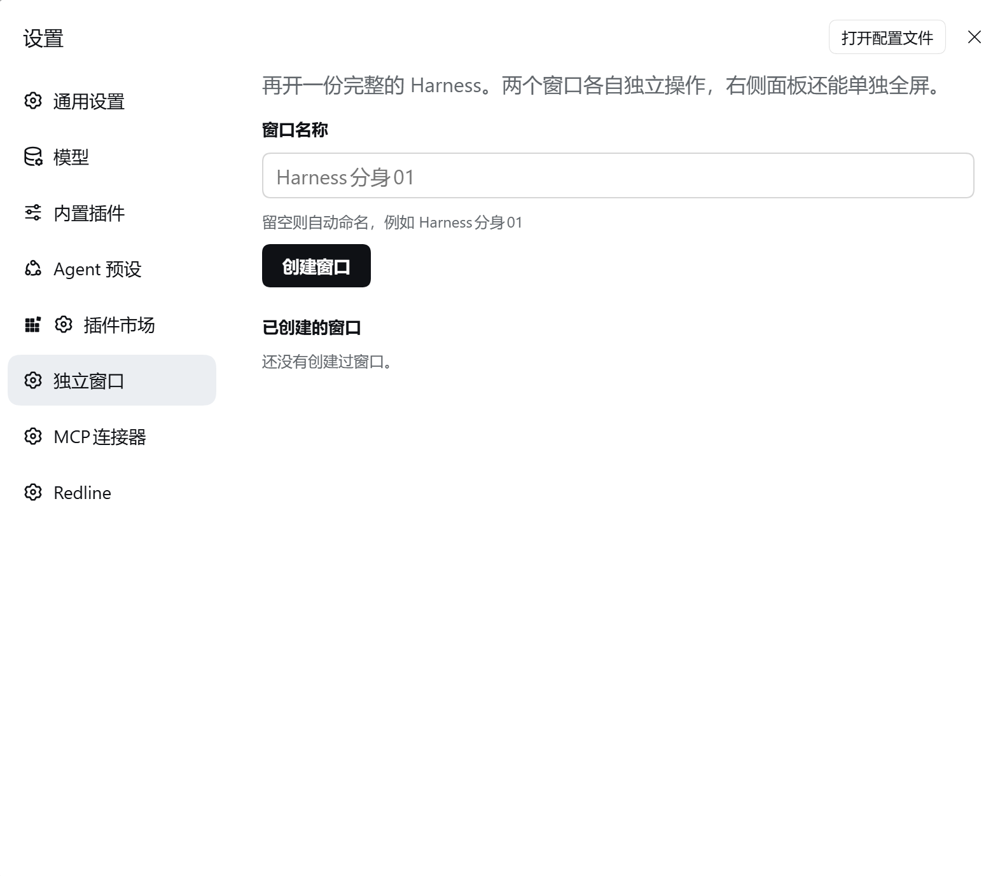

# dsh-window-clone

[English](README.md) · 简体中文

[](https://www.npmjs.com/package/dsh-window-clone)

**再开一个 DeepSeek Harness 视图，两处同时干活。**

`dsh-window-clone` 是 [DeepSeek Harness](https://github.com/deepseek-ai/deepseek-harness) 的插件，把"再开一份完整 Harness"变成一次点击。在设置里输入窗口名，点「创建窗口」，就得到一个独立的 Harness 窗口 —— 已经登录、独立于原窗口、标题由你决定。两个窗口驱动同一个 Harness —— 同一份会话、同一份工作区，实时同步 —— 但各自保留自己的面板布局，所以可以一边全屏文件、一边全屏终端，各就各位。

```bash
dsh plugin --profile web add dsh-window-clone
```



---

## 为什么要有它

用 DSH 干活经常要同时看两处：一边跑着长任务，一边读文档；或者一个窗口写代码，另一个窗口查资料。在一个窗口里来回切面板，每次都要重新找回位置。

再开一个窗口就不用切了：一个窗口盯文件，一个窗口盯终端，两个都活在同一场对话上。

## 用起来是这样

1. 打开 **设置 → 独立窗口**
2. 输入窗口名 —— 或者留空
3. 点 **创建窗口**

新窗口出现，标题就是你填的名字；留空则自动叫 `Harness分身01`、`Harness分身02`…… 它已经登录，不是原窗口的子窗口，关掉任意一个都不影响另一个。

每个窗口都是完整的 Harness。一个放文件面板，一个放终端，各自全屏，于是你有两个专注的工作区，而不是一个挤满了的。

## 功能

- **自定义窗口名** —— 标题你说了算，任务栏上就能看出每个窗口在做什么
- **真正的独立窗口** —— 没有地址栏，可以拖到另一个显示器
- **两个窗口实时同步** —— 会话、消息、工作区随操作即时反映到另一窗口
- **各窗口自有面板布局** —— 每个窗口保留自己的排布，可以各自全屏不同的面板
- **打开即已登录** —— 不需要二次登录
- **创建记录** —— 设置页会记住你建过哪些窗口
- **English 与 简体中文**

右侧面板全屏是 DSH 自带的功能（面板右上角那个按钮），不是这个插件加的。

## 安装

```bash
dsh plugin --profile web add dsh-window-clone
dsh web
```

重启 Harness（或重新运行 `dsh web`），打开设置 —— **独立窗口** 会出现在 *市场* 和 *MCP* 之间。

### 其他安装方式

从 GitHub 安装（用于 registry 上还没有的版本）：

```bash
dsh plugin --profile web add git+https://github.com/JhengFire/dsh-window-clone.git
```

锁定某个版本：

```bash
dsh plugin --profile web add git+https://github.com/JhengFire/dsh-window-clone.git#v1.0.0
```

从本地目录安装：

```bash
dsh plugin --profile web add ./dsh-window-clone
```

### 国内网络加速

包会自动同步到 npmmirror，直接用国内镜像安装即可：

```bash
npm install dsh-window-clone --registry=https://registry.npmmirror.com
```

## 原理

网页打不开操作系统窗口，所以插件按 DSH 插件一贯的双端结构分工。

**Host 端**（`lib/index.mjs`）负责两个路由和启动器：

| 路由 | 作用 |
| --- | --- |
| `POST /detach/open` | 启动一个 Harness 窗口，返回窗口名 |
| `GET /detach/state` | 报告本机有哪些可用启动方式 |

窗口是**新起的进程，不是 iframe**：

```js
spawn(shellExe, [], { detached: true, stdio: 'ignore' }).unref()
```

`detached` 加 `unref` 让新窗口独立于原窗口。找不到 shell 可执行文件时，降级用 Chrome/Edge 的 `--app=` 模式，同样是无地址栏窗口。

**认证**用 Host 自己的机制。窗口打开的是带进程启动令牌的地址（`connection.authenticatedUrl()`），落地时换取 cookie —— 所以第一帧就是登录态，而不是登录页。

**窗口标题**走 URL fragment（`#dsh-clone-name=…`）。fragment 不发给服务器，而且能在登录跳转后保留（查询串会被丢掉）。页面读到后写入标题，并监听 `<head>` 变化持续维护，防止 Harness 异步改名。

**浏览器端**（`lib/client.js`）通过 `settings.section` 这个位置贡献设置页，文件形状与官方客户端插件一致：严格模式 IIFE、一次 `window.__ModuleLoader__.load({ id, factory })` 注册、在 factory 内赋值 `module.exports`。

## 环境要求

- DeepSeek Harness 桌面版 0.2.x
- Windows、macOS、Linux
- Chrome 或 Edge —— 仅降级路径需要

## 一个 Harness，多个窗口

**每个窗口都是同一个 Harness 的一个视图 —— 这是设计，不是限制。**

这正是它的意义所在。所有窗口连的是同一个 Harness 实例，所以一切保持同步：

- **会话与消息** —— 一个窗口里发起的回合，在另一个窗口里随生成实时出现
- **工作区** —— 文件、终端、浏览器面板反映的是同一份状态
- **设置、预设、插件** —— 改一次，处处生效
- **各窗口自己的面板排布** —— 每个窗口保留自己的面板布局，因为布局属于视图状态，不属于 Harness 状态

所以窗口不是把你正在做的事复制一份，而是**看同一件事、做同一件事的另一个地方**。一个窗口开文件树、另一个开终端，各自全屏，两个窗口看到的是同一场对话的不同切面 —— 在任何一边开始，都能从另一边看到。

## 边界

**一个 Harness 实例，一台机器。** 窗口开在提供服务的 Host 上，不跨机器协同。

**"每个面板一个原生窗口"在这里做不到。** 桌面壳 `deepseek-harness.exe` 是打包的 Electron 应用，永远加载自己的 `app.asar`，不接受外部应用路径 —— 传给它自定义路径会立刻退出（这一点直接验证过）。所以本插件改为复制整个 Harness，再配合 DSH 自带的全屏，得到同样的实际效果：一个窗口一件事。

## 排错

**设置里找不到「独立窗口」。** 客户端 bundle 没加载。硬刷新界面（`Ctrl+Shift+R`），让浏览器丢掉旧版本缓存；仍然不行就看浏览器控制台里有没有 `client-modules` 报错并提到这个包名。

**窗口开了但显示登录页。** 启动令牌没送到窗口。`GET /detach/state` 会告诉你找到了哪种启动方式；如果既没有 `shell` 也没有 `browser`，说明这台机器没有可用启动器。

**标题不对。** 部分浏览器 app 模式会让页面覆盖窗口标题。具体情况请开 issue。

## 开发

纯 Node.js 加 React，没有构建步骤。

```bash
node --check lib/index.mjs
node --check lib/client.js
```

`lib/index.mjs` 是 Host 端，必须是 ESM。`lib/client.js` 是模块加载器加载的普通浏览器脚本，不是 ES 模块 —— Node 不会 import 它。

## 许可

[MIT](LICENSE)